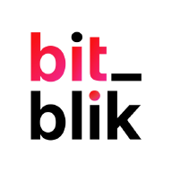

<p align="center">
  
</p>

# BitBlik on StartOS

> Everything not listed in this document should behave the same as upstream
> BitBlik. If a feature, setting, or behavior is not mentioned here, the
> upstream documentation is accurate and fully applicable — see the
> Documentation section of `instructions.md` for links.

[BitBlik](https://github.com/bit-blik/bitblik) is a peer-to-peer client for
exchanging Bitcoin over Lightning for BLIK payment codes through Nostr-based
coordinators. This package runs its browser client on StartOS.

- **Upstream repo:** <https://github.com/bit-blik/bitblik>
- **Wrapper repo:** <https://github.com/Start9-Community/bitblik-startos>

---

## Table of Contents

- [Image and Container Runtime](#image-and-container-runtime)
- [Volume and Data Layout](#volume-and-data-layout)
- [File Models](#file-models)
- [Dependencies](#dependencies)
- [Network Access and Interfaces](#network-access-and-interfaces)
- [Installation and First-Run Flow](#installation-and-first-run-flow)
- [Actions](#actions)
- [Tasks](#tasks)
- [Health Checks](#health-checks)
- [Backups and Restore](#backups-and-restore)
- [Limitations and Differences](#limitations-and-differences)
- [Quick Reference for AI Consumers](#quick-reference-for-ai-consumers)

---

## Image and Container Runtime

Package uses upstream's unmodified, commit-tagged web image.

| Property      | Value                      |
| ------------- | -------------------------- |
| Image         | `ghcr.io/bit-blik/app-web` |
| Architectures | x86_64, aarch64            |
| Entrypoint    | Upstream image entrypoint  |

| Subcontainer | Purpose                                 |
| ------------ | --------------------------------------- |
| `bitblik`    | Nginx server for the Flutter web client |

StartOS supplies `PAYMENT_SYSTEM=blik` on every launch. Upstream entrypoint
renders this runtime setting into the client configuration before starting
Nginx.

## Volume and Data Layout

One volume holds the package's own state; the container serves static files and
mounts no volume.

| Volume | Mount point | Contents                                             |
| ------ | ----------- | ---------------------------------------------------- |
| `main` | not mounted | `store.json` — the URL chosen in **Set Primary URL** |

Neko identity, settings, and browser session data remain inside browser storage
for the exact origin used to open BitBlik.

## File Models

One file model, read only by the StartOS package.

| File         | Volume | Purpose                                       |
| ------------ | ------ | --------------------------------------------- |
| `store.json` | `main` | `primaryUrl`, the address **Open UI** prefers |

Absent until **Set Primary URL** first runs, which rewrites it each time. A
hand edit survives, and is ignored if it names a hostname the interface no
longer has.

## Dependencies

None. Package does not require another StartOS service. Browser connects to
Nostr relays, selected coordinators, and wallet providers directly.

## Network Access and Interfaces

One browser interface exposes the web client.

| Interface     | Id   | Type | Internal Port | Protocol                      |
| ------------- | ---- | ---- | ------------- | ----------------------------- |
| Web Interface | `ui` | ui   | 80            | HTTP with StartOS TLS wrapper |

**Open UI** prefers the address chosen in **Set Primary URL**, which offers
HTTPS addresses only, because browser secure identity storage does not
initialize over plain HTTP. Until one is chosen, or while the chosen hostname is
gone, it prefers a public domain, else the `.local` address.

## Installation and First-Run Flow

No account, credential, setup task, or server-side initialization exists.
First browser opening creates or imports a Neko identity inside that browser
profile. User must export identity backup before trading.

## Actions

One user-facing action.

| Action          | Purpose                                    |
| --------------- | ------------------------------------------ |
| Set Primary URL | Choose the HTTPS address **Open UI** opens |

Run it once you know which address you will use BitBlik from, and again only
to move to another one — identity stored at the old address stays there, so
export it first. It changes nothing but the launcher preference, needs no
restart, and is safe to repeat.

## Tasks

None. Package raises no tasks, so service startup is never blocked by a setup
prompt.

## Health Checks

One readiness check belongs to the only daemon.

| Check     | Displayed     | Method               |
| --------- | ------------- | -------------------- |
| `bitblik` | Web Interface | Port 80 is listening |

Failure means Nginx did not bind its port. Inspect service logs for image,
entrypoint, or runtime configuration errors.

## Backups and Restore

Backups copy the `main` volume, so a restore keeps the primary URL. If its
port changed in the restore, **Open UI** follows the same hostname to its new
port.

Browser-local Neko identity and settings are not part of StartOS backups.
Recovery depends on backup exported from BitBlik itself.

## Limitations and Differences

1. Browser identity is origin- and profile-specific. Opening another hostname,
   device, or browser profile creates separate storage.
2. Plain HTTP cannot initialize secure identity storage. **Set Primary URL**
   offers HTTPS addresses only.
3. Package runs only BitBlik web client. It does not run a coordinator,
   Lightning node, Nostr relay, or wallet backend.
4. StartOS cannot back up browser-local identity or settings.

---

## Quick Reference for AI Consumers

```yaml
package_id: bitblik
image: ghcr.io/bit-blik/app-web
architectures:
  - x86_64
  - aarch64
subcontainers:
  - bitblik
volumes:
  main: { mount: null }
file_models:
  - main/store.json
startos_managed_env_vars:
  - PAYMENT_SYSTEM
dependencies: []
interfaces:
  ui: { type: ui, port: 80 }
actions:
  - set-primary-url
tasks: []
health_checks:
  - bitblik
```
